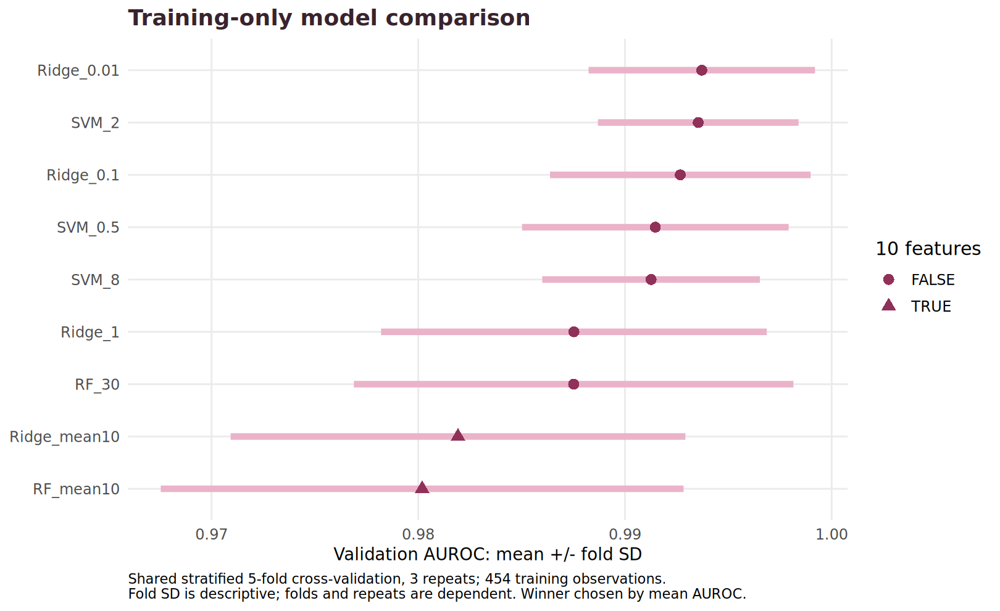
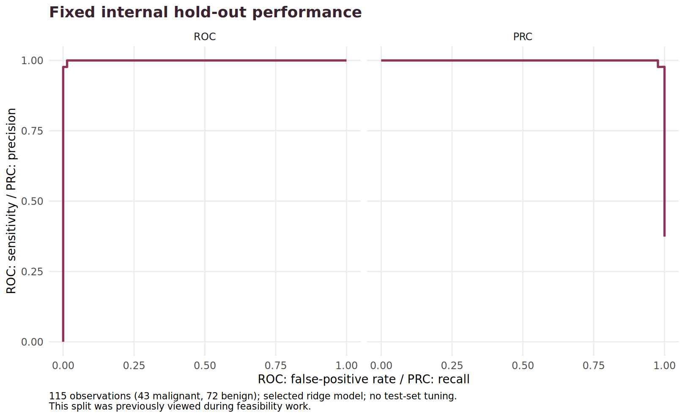
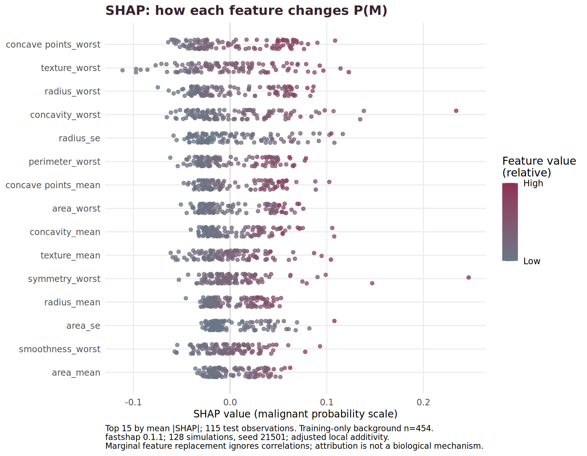

Reproducible R package for the same trained model used by the
[BIO215 Shiny application](https://legacccy.shinyapps.io/bio215-wisconsin-feasibility/).
The prediction target is the recorded benign/malignant diagnosis in the
[Kaggle Wisconsin Diagnostic dataset](https://www.kaggle.com/datasets/uciml/breast-cancer-wisconsin-data).
This is a course demonstration, not a clinical diagnostic service.

## Installation

Install from the public [GitHub repository](https://github.com/legacccy/BIO215).
No GitHub account or token is needed to download this public package.


```r
install.packages("remotes")
remotes::install_github("legacccy/BIO215")
```

The source archive can already be installed locally:


```r
install.packages(file.choose(), repos = NULL, type = "source")
```

Select the supplied `BIO215_0.1.0.tar.gz`. Install `glmnet`, `randomForest` and
`e1071` from CRAN first if not present. Tested locally with R 4.3.3 on Ubuntu
24.04 under WSL. Automated checks run on Ubuntu and Windows through
[GitHub Actions](https://github.com/legacccy/BIO215/actions). Consult the latest
completed run for the tested R versions and platform results.

## Predict classes


```r
x <- example_bio215()
dim(x)
#> [1]  3 30
predict_bio215(x)
#> [1] Malignant Malignant Malignant
#> Levels: Benign Malignant
predict_bio215(x, type = "probability")
#> [1] 0.9986016 0.6179489 0.9506629
```

`predict_bio215()` defaults to a factor with levels `Benign` and `Malignant`.
It returns classes, not probabilities, unless explicitly requested. The fixed
threshold is P(M) >= 0.5. No training or network request occurs during prediction.

For your own CSV, use `read.csv(path, check.names = FALSE)` to preserve exact
column names. Provide all 30 numeric feature columns shown by `names(x)`.
Column order does not matter; extra columns are ignored. Duplicate names,
missing columns, nonnumeric values, NA, NaN, Inf, zero rows and more than 1,000
rows produce informative errors. No automatic imputation or unit conversion
is applied. Preserve the original measurement scale.

## Explain one prediction


```r
s <- explain_bio215(x)
cbind(baseline_logodds = s$baseline,
      contribution_sum = rowSums(s$values),
      reconstructed_probability = s$probability_M)
#>      baseline_logodds contribution_sum reconstructed_probability
#> [1,]       -0.6784141         7.249408                 0.9986016
#> [2,]       -0.6784141         1.159265                 0.6179489
#> [3,]       -0.6784141         3.636898                 0.9506629
stopifnot(max(abs(s$probability_M - predict_bio215(x, "probability"))) < 1e-12)
```

These are exact interventional SHAP values for the **linear log-odds** model:
coefficient times the difference from the training feature mean. Baseline plus
all contributions reconstructs the log-odds; `plogis()` converts it to P(M).
The Shiny Analysis tab separately presents **probability-scale Monte Carlo
SHAP**, using fastshap 0.1.1, 128 simulations and a training-only background.
Do not compare contribution sizes across the two scales. Both explanations
use marginal feature replacement and do not establish causal mechanisms.

## Data and evaluation protocol

The dataset contains 569 records, 357 benign and 212 malignant, with 30 numeric
features. ID, diagnosis and the empty CSV column are excluded from predictors.
The fixed seed-123 stratified split contains 454 training observations
(285 benign, 169 malignant) and 115 test observations (72 benign, 43 malignant).

Nine prespecified configurations compare random forests, ridge logistic models
and radial SVMs. Shared stratified five-fold cross-validation is repeated three
times on training data only. Standardization is learned within fitting folds.
The highest mean validation AUROC selects the model. Fold SD is descriptive;
folds and repeats are dependent, and these selection scores are not an unbiased
final estimate. A fixed 10-mean-feature reduction is also evaluated.


|candidate    | n_features| AUROC_mean| AUROC_sd| sensitivity_mean| specificity_mean|
|:------------|----------:|----------:|--------:|----------------:|----------------:|
|Ridge_0.01   |         30|     0.9937|   0.0055|           0.9488|           0.9906|
|SVM_2        |         30|     0.9935|   0.0049|           0.9547|           0.9789|
|Ridge_0.1    |         30|     0.9927|   0.0063|           0.9036|           0.9965|
|SVM_0.5      |         30|     0.9915|   0.0064|           0.9488|           0.9766|
|SVM_8        |         30|     0.9913|   0.0053|           0.9449|           0.9801|
|Ridge_1      |         30|     0.9875|   0.0093|           0.8247|           0.9930|
|RF_30        |         30|     0.9875|   0.0106|           0.9330|           0.9602|
|Ridge_mean10 |         10|     0.9819|   0.0110|           0.8405|           0.9766|
|RF_mean10    |         10|     0.9802|   0.0126|           0.9074|           0.9497|


The selected ridge model uses 30 features, alpha = 0, lambda = 0.01 and is refitted
on all 454 training records with seed 21500. SVM and ridge validation scores are
close; no statistical superiority is claimed. Feature reduction lowered
validation AUROC, so the full input set was retained. The model and prediction
source are byte-identical between the package and Shiny application.


|candidate  | train_n| test_n| test_B| test_M| accuracy| sensitivity| specificity| precision|       F1|    AUROC|    AUPRC|    Brier| TP| TN| FP| FN|
|:----------|-------:|------:|------:|------:|--------:|-----------:|-----------:|---------:|--------:|--------:|--------:|--------:|--:|--:|--:|--:|
|Ridge_0.01 |     454|    115|     72|     43| 0.991304|           1|    0.986111|  0.977273| 0.988506| 0.999677| 0.999465| 0.012435| 43| 71|  1|  0|


Table: 95% intervals: Wilson binomial for accuracy/sensitivity/specificity; 1,000 stratified bootstrap resamples for remaining metrics.

|metric      |  lower|  upper|method               |
|:-----------|------:|------:|:--------------------|
|accuracy    | 0.9524| 0.9985|Wilson binomial      |
|sensitivity | 0.9180| 1.0000|Wilson binomial      |
|specificity | 0.9254| 0.9975|Wilson binomial      |
|F1          | 0.9663| 1.0000|Stratified bootstrap |
|AUROC       | 0.9981| 1.0000|Stratified bootstrap |
|AUPRC       | 0.9969| 1.0000|Stratified bootstrap |
|Brier       | 0.0061| 0.0209|Stratified bootstrap |









Table: Largest mean absolute probability-scale SHAP contributions across 115 test observations.

|feature              | mean_absolute_SHAP|
|:--------------------|------------------:|
|concave points_worst |            0.03947|
|texture_worst        |            0.03741|
|radius_worst         |            0.03734|
|concavity_worst      |            0.03664|
|radius_se            |            0.03360|


The largest mean absolute contributions involve worst concave points (contour
indentations), worst texture (grayscale variation), and worst radius (nuclear
size). They describe information used by this fitted classifier, not causal
drivers of cancer. An independent 512-simulation calculation on the first 10
test records was compared with the 128-simulation explanations; the retained
diagnostic reports approximation differences rather than claiming exact
probability-scale attributions.

Nuclear size and contour measurements can correlate strongly. SHAP allocations
may be shared across related features, and permutation importance can understate
substitutable inputs. The original feature documentation defines `worst` as the
mean of the three largest values. These are measurements from cell-nucleus
images of breast-mass aspirates, not symptoms or general population screening
variables.

## Limits and reproducibility

The test split was already inspected during earlier feasibility work. It is a
fixed internal audit, **not an untouched or external validation cohort**. The
candidate search, threshold and winner were not revised using the new test
result. There is no independent institution, prospective evaluation or clinical
calibration. Perfect sensitivity in 43 malignant test records is not proof of
perfect sensitivity in practice. Bootstrap intervals do not capture dataset
shift or model-selection uncertainty. No patient demographic subgroup analysis
is possible from the supplied feature table alone.

The package includes full function help, example data, held-out predictions,
feature data and tests. `R CMD check --no-manual` runs the examples and tests.
The source repository includes an Ubuntu/Windows GitHub Actions workflow.
The wider course workspace retains fold assignments, all validation predictions,
configuration grids, timing, session information and SHAP stability diagnostics.

## Attribution and licensing

Code: MIT, copyright Jia Yu (2026). Contact: legacccy1@gmail.com.
Data and example observations: CC BY 4.0, separately attributed to Wolberg,
Mangasarian and Street, *Breast Cancer Wisconsin (Diagnostic)*,
[UCI DOI 10.24432/C5DW2B](https://doi.org/10.24432/C5DW2B), Kaggle mirror by uciml.
The data license is distinct from the source-code license. Predictions and
derived evaluation figures are educational analysis of this dataset.

Method references: [glmnet documentation](https://glmnet.stanford.edu/articles/glmnet.html),
[fastshap documentation](https://bgreenwell.github.io/fastshap/reference/explain.html),
[linear SHAP documentation](https://shap.readthedocs.io/en/latest/generated/shap.LinearExplainer.html).
